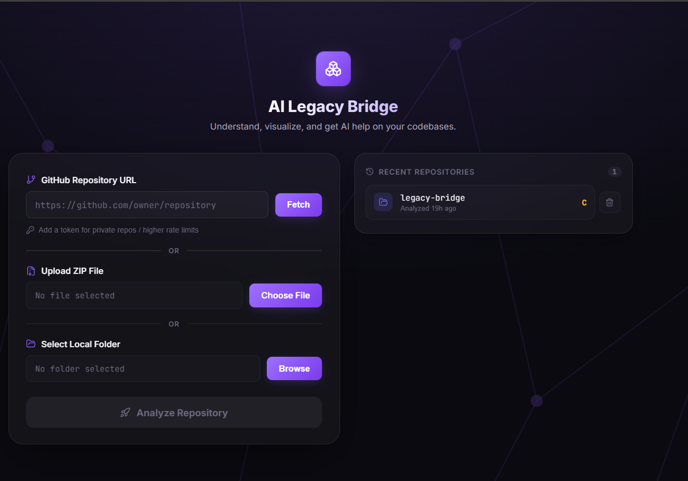
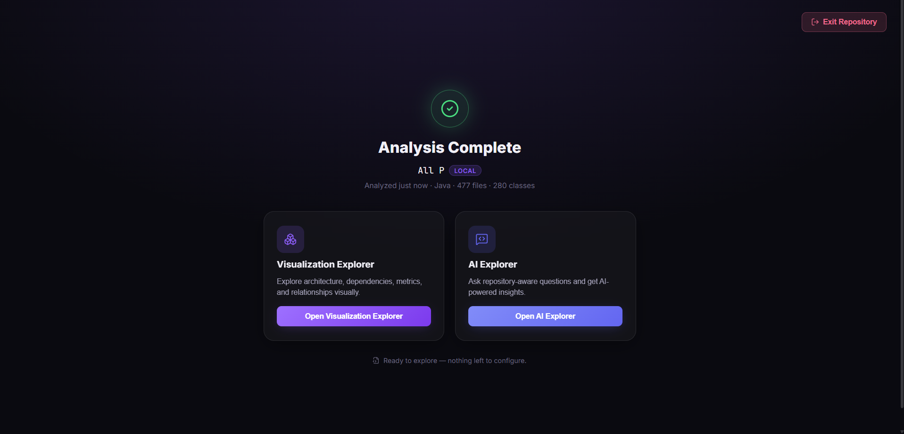
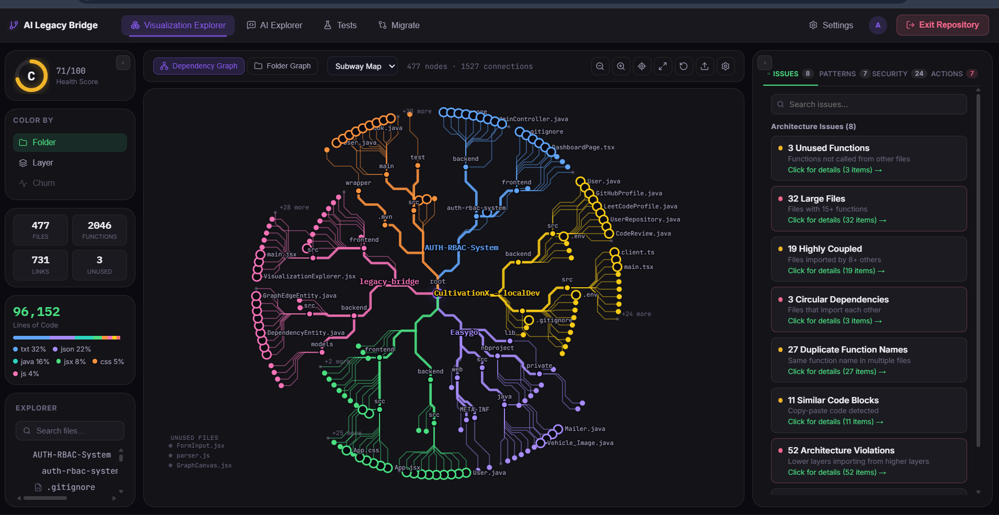
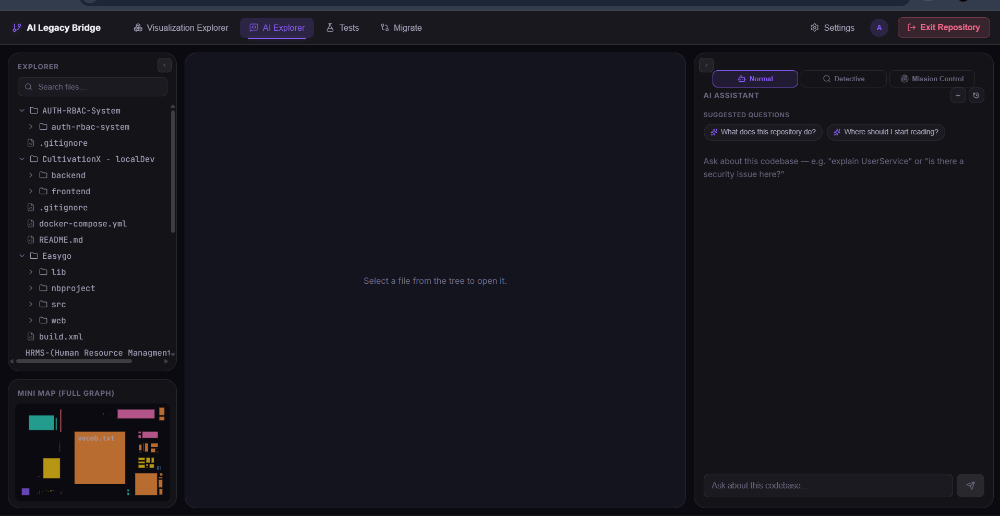
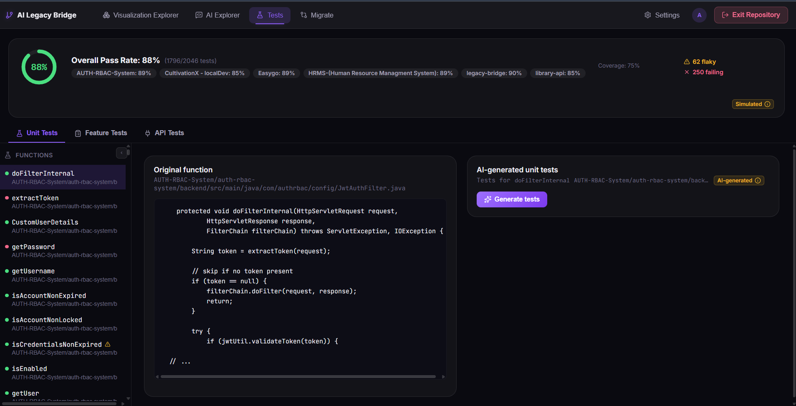
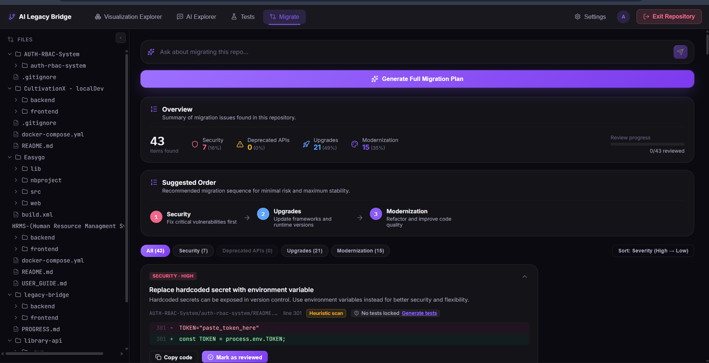

# AI Legacy Bridge — AI-Powered Legacy Code Intelligence Platform

Upload a legacy codebase, get an interactive dependency graph, and ask an AI agent questions about it — with real source-grounded answers, migration suggestions, and auto-generated tests.

<!-- 
  SCREENSHOTS: replace the placeholders below with your own images.
  Put your image files in a `docs/screenshots/` folder in the repo root,
  then update the paths below to match your filenames.
-->

## Screenshots

| Upload & Analyze | WorkSpace Selection |
|---|---|
|  |  |
| Visulization Explorer | Ai Explorer |
|  |  |

| Test you code | Migration Suggestions |
|---|---|
|  |  |

## Overview

AI Legacy Bridge helps developers understand and modernize unfamiliar or legacy codebases. You upload a repository (ZIP, folder, or GitHub link), the frontend's in-browser Analysis Engine parses it into files/classes/functions/dependencies, and the backend stores that structure while a Python AI service indexes it for retrieval-augmented Q&A.

From there you can:
- **Visualize** the codebase as an interactive dependency graph
- **Ask an AI agent** questions about any file, with the currently open file always used as grounded context (not just retrieved chunks)
- **Generate unit tests** for a function
- **Get migration suggestions** for legacy patterns
- Come back later — repositories are saved and reloadable without re-analyzing

## Architecture

```
 Frontend (React + Vite)        Backend (Spring Boot)         AI Service (FastAPI)
 ────────────────────────       ──────────────────────        ──────────────────────
 Analysis Engine (browser)         ingest/  → stores            guardrail check
   parses repo → graph        →    query/   → read APIs    →    GraphRAG retrieval
 UI: Upload / Graph /              storage/ → JPA entities       (pgvector + Neo4j)
     AI Explorer / Tests /         Postgres + pgvector      →    LangGraph agent loop
     Migrate                                                     (tools: read_file,
                                                                   search_code, etc.)
                                                                  evaluation + tests
```

- **Frontend** does the actual code parsing (AST-based) client-side, then posts the finished analysis to the backend — the backend never parses source itself.
- **Backend (Java/Spring Boot)** is the system of record: stores files/classes/functions/dependencies in Postgres, serves the Upload Page's "recent repositories" list, and triggers the AI service to index a repo after ingest.
- **AI service (Python/FastAPI)** owns retrieval and the agent: chunks + embeds code (`sentence-transformers`), mirrors dependencies into Neo4j for **GraphRAG** (semantic similarity + graph proximity combined), runs a **LangGraph** agent with tool-calling and multi-turn memory, and gates every question through a guardrail step.

## Tech Stack

| Layer | Tech |
|---|---|
| Frontend | React 19, Vite, Monaco Editor, D3.js, Acorn (JS parsing) |
| Backend | Java 21, Spring Boot 3.3, Hibernate 6, PostgreSQL + pgvector |
| AI Service | Python, FastAPI, LangChain / LangGraph, Neo4j, sentence-transformers |
| LLM | Groq (Llama 3.3) / Gemini, OpenAI-compatible chat completions |

## Project Structure

```
AI-Legacy-Bridge/
├── frontend/          React + Vite app — upload UI, graph visualization, AI Explorer
├── backend/           Spring Boot service — storage, ingest/query APIs
└── ai-service/         FastAPI service — RAG indexing, LangGraph agent, guardrails
```

## Getting Started

### Docker Setup (Recommended)

Run the full application with **Docker Compose**: React/Nginx, Java 21 Spring Boot, Python FastAPI/AI Service, and PostgreSQL 18 with pgvector. **Neo4j GraphRAG is optional.** You only need Docker Desktop with Docker Compose; Java, Python, Node.js, and PostgreSQL do not need to be installed separately on your computer.

#### 1. Clone and configure

```bash
git clone https://github.com/aadityahammad-2002/AI-Legacy-Bridge.git
cd AI-Legacy-Bridge
```

Copy the root `.env.example` to **root `.env`**:

```powershell
# Windows PowerShell
Copy-Item .env.example .env
notepad .env
```

On Linux/macOS use `cp .env.example .env`. Set a strong `POSTGRES_PASSWORD` and your own `LEGACYBRIDGE_LLM_API_KEY` (Gemini by default). The root `.env` is gitignored and **must not** be committed. Docker passes the configuration to the AI service automatically; `ai-service/.env` is only needed for manual runs.

#### 2. Start the complete stack

```bash
docker compose config --quiet
docker compose up --build -d
docker compose ps
```

Open **http://localhost:5173**. Other local endpoints:

| Service | Address |
|---|---|
| Frontend | http://localhost:5173 |
| Spring Boot API | http://localhost:8080 |
| FastAPI / Swagger | http://localhost:8001/docs |
| AI service health | http://localhost:8001/health |

The first build downloads container images and dependencies; the semantic embedding model may download on first use. Before running Docker, stop any local frontend, Java, or Python processes occupying ports **5173, 8080, or 8001**.

#### 3. Optional Neo4j GraphRAG

By default, Neo4j is disabled and the AI service uses PostgreSQL/pgvector with its PostgreSQL dependency-graph fallback. To enable Neo4j, set a strong `NEO4J_PASSWORD` in **root `.env`**, then run:

```bash
docker compose --profile graph up --build -d
```

Neo4j Browser: **http://localhost:7474** (username: `neo4j`; password: the value in root `.env`). Graph data for previously ingested repositories may require re-indexing.

#### 4. Check, restart, or stop

```bash
# View logs and container status
docker compose logs --tail=100
docker compose ps

# Stop containers without deleting stored data
docker compose down

# Rebuild after application code changes
docker compose up --build -d
```

For the Neo4j configuration, use `docker compose --profile graph down` to stop the graph container too. The Docker database uses a persistent named volume, **independent of any PostgreSQL installed on your computer**. Existing Windows databases are not imported automatically. Avoid `docker compose down -v` unless you intentionally want to delete Docker-managed data.

> This is a **local development** setup, not a public production deployment: the application has no authentication. Container build and end-to-end Docker runtime still need to be validated on a machine with Docker Desktop.

More details and troubleshooting: [Docker Setup Guide](DOCKER_SETUP.md).

---

### Prerequisites
- Node.js 18+
- Java 21 + Maven
- Python 3.11+
- PostgreSQL with the `pgvector` extension
- (Optional, for GraphRAG) Neo4j

### 1. Backend

```bash
cd backend
# create the DB/user referenced in application.properties, then:
mvn spring-boot:run
```

Copy `src/main/resources/Example.application.properties` → `application.properties` and fill in your own DB credentials — **never commit real credentials**.

### 2. AI Service

```bash
cd ai-service
pip install -r requirements.txt --break-system-packages
cp example.env .env   # fill in your LLM API key, DB, and (optional) Neo4j config
python -m app.main
```

API docs at `http://localhost:8001/docs`.

### 3. Frontend

```bash
cd frontend
npm install
cp .env.example .env   # point at your backend / ai-service URLs
npm run dev
```

## Features

- 📂 Upload via ZIP, local folder, or GitHub URL
- 🕸️ Interactive dependency graph (files, classes, functions, imports)
- 🤖 AI Explorer — ask questions grounded in real source, not just guesses
- 🧪 Auto-generated unit tests for a selected function
- 🔧 Migration suggestions for legacy code patterns
- 💾 Session persistence — reopen a previously analyzed repository instantly

## Known Limitations

- No authentication yet — intended for local/dev use

## License

This project is licensed under the [MIT License](LICENSE).
 

## Author

Built by [Aaditya](https://github.com/aadityahammad-2002)
